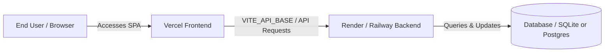

# Return Rescue - Cloud Deployment Guide
**Deploying Frontend on Vercel + Backend on Render / Railway**

This guide provides step-by-step instructions to deploy the complete **Return Rescue** platform to the cloud for free using **Vercel** (for the React SPA) and **Render** (for the Django REST Framework API).

---

## 🏗️ Architecture Overview



- **Frontend (Vercel)**: Fast global CDN serving the React 19 + Vite SPA, client-side routing, and interactive 3D scene.
- **Backend (Render / Railway)**: High-performance Gunicorn WSGI server running Django REST Framework with Token Authentication, AI rules engine, and role management.

---

## 🚀 Step 1: Deploy Backend to Render (or Railway)

### Option A: Using Render (Recommended & Free)
1. Sign in to [Render Dashboard](https://dashboard.render.com/).
2. Click **New +** → Select **Web Service**.
3. Choose **Build and deploy from a Git repository** → Connect your repository:
   ```
   https://github.com/jothimani7806/Return_rescue.git
   ```
4. Fill in the service configuration:
   - **Name**: `return-rescue-backend` (or your preferred name)
   - **Region**: Choose the closest region (e.g. Frankfurt, Oregon, Singapore)
   - **Branch**: `main`
   - **Root Directory**: `backend`
   - **Runtime**: `Python 3`
   - **Build Command**: `bash build.sh`
   - **Start Command**: `gunicorn return_rescue.wsgi:application --bind 0.0.0.0:$PORT`
   - **Instance Type**: `Free`
5. Click **Advanced** and add Environment Variables:
   - `PYTHON_VERSION` = `3.11.9`
   - `DEBUG` = `False`
   - `SECRET_KEY` = (Click *Generate* or enter a random string)
   - `CSRF_TRUSTED_ORIGINS` = `https://*.vercel.app,https://*.onrender.com`
6. Click **Create Web Service**.
7. Render will install dependencies, run migrations, seed initial demo accounts (including default manager *Jothimani*), and start Gunicorn.
8. **Copy your backend public URL** once deployment finishes:
   ```
   https://return-rescue-backend.onrender.com
   ```

---

## ⚡ Step 2: Deploy Frontend to Vercel

1. Sign in to [Vercel](https://vercel.com/) with your GitHub account.
2. Click **Add New...** → **Project**.
3. Import the repository **`jothimani7806/Return_rescue`**.
4. Configure Project Settings:
   - **Framework Preset**: `Vite`
   - **Root Directory**: Click *Edit* and select **`frontend`** (or leave root since `vercel.json` is provided)
   - **Build Command**: `npm run build`
   - **Output Directory**: `dist`
5. Expand **Environment Variables**:
   - **Key**: `VITE_API_BASE`
   - **Value**: `https://<YOUR-RENDER-BACKEND-URL>/api`
     *(Example: `https://return-rescue-backend.onrender.com/api`)*
6. Click **Deploy**.
7. Vercel will build the frontend and provide your live production URL:
   ```
   https://return-rescue-xxx.vercel.app
   ```

---

## 🔒 Step 3: Verify the Live Deployment

1. Open your Vercel URL: `https://return-rescue-xxx.vercel.app/login`
2. **Test Customer Portal**:
   - Click **Customer Demo** (`customer` / `Customer@123`)
   - Click **Sign In** → Verify redirection to `/customer/dashboard`.
3. **Test Manager Portal (in a 2nd tab)**:
   - Open a new tab to `https://return-rescue-xxx.vercel.app/manager/login`
   - Click **Manager Demo** (`manager` / `Manager@123`)
   - Click **Sign In** → Verify greeting displays: **`Hello, Jothimani`**.
4. **Test Settings & Profile Customizer**:
   - In either portal, click the profile avatar or settings gear icon.
   - Change your name manually and save.
5. **Test Return Queue & Deletion**:
   - In Manager Portal, navigate to **Return Queue**.
   - Review records and click the red trash icon to delete test records with full safety confirmation.

---

## 🐳 Optional: Single-Command Docker Deployment (VPS / Self-Hosted)

If deploying to your own Linux VPS (Ubuntu / Debian / EC2 / DigitalOcean Droplet):
```bash
# Clone and run
git clone https://github.com/jothimani7806/Return_rescue.git
cd Return_rescue
python run_single_port.py --port 8000
```
